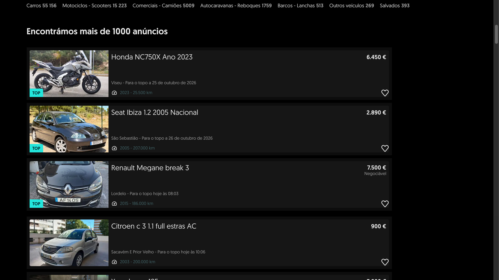

# OLX & Standvirtual Dark

An unofficial dark theme for [olx.pt](https://www.olx.pt) and
[standvirtual.com](https://www.standvirtual.com), with an OLED-black palette on OLX and
the sites' own dark palette on Standvirtual. One toolbar button turns it on and off for
both.

Both sites are built on the same OLX Group design system, so the theme works the same way
on each: it overrides the design tokens rather than inverting colours, so components keep
their layout, hierarchy and brand accent — only the palette changes.

### OLX.pt — cars listings



### Standvirtual.com — home


## Install

**From a release** (no git needed):

1. Download [`olx-dark-theme.zip`](https://github.com/AndreVarandas/olx-dark-theme/releases/latest/download/olx-dark-theme.zip)
   and unzip it
2. Open `chrome://extensions`
3. Turn on **Developer mode**
4. **Load unpacked** → select the unzipped folder

Or clone this repo and **Load unpacked** on the repo folder instead — it is the
dependency-free source, no build step.

Either way the theme is on by default. Click the toolbar icon to toggle it; the badge
shows `ON` / `OFF`.

## Permissions

The extension runs on six exact origins and nothing else:

- `olx.pt`, `www.olx.pt`
- `standvirtual.com`, `www.standvirtual.com`, `m.standvirtual.com`, `login.standvirtual.com`

Everything else on those domains — the help centres, blogs, static asset hosts and
sibling apps such as `carros.standvirtual.com` — is out of reach. OLX serves a separate
mobile template on `m.olx.pt`, which it redirects desktop browsers to below roughly a
1280-px viewport; that template is a different app and is deliberately not themed.

It requests `storage` (the on/off preference) and `scripting` (registering the stylesheets
while the theme is on). It does **not** request `tabs`, `webRequest`, `cookies` or
`<all_urls>`, and it declares no `externally_connectable`, so web pages cannot message it.
The stylesheets are inert unless the host's flag attribute is present, and the content
script only sets that flag on the hosts above.

## How it works

Each site's stylesheets are registered as a **content script only while the theme is
enabled**, at `document_start`, so there is no white flash on navigation. Every rule is
scoped to that site's flag (`html[data-olxd="1"]` or `html[data-svd="1"]`), which is what
makes toggling instant: dropping the flag restores the light site without a reload.

### OLX.pt

React + Tailwind themed through semantic CSS custom properties
(`--color-background-primary`, `--colorsBackgroundSecondary`, …). Three details matter:

- **Overrides must target `html`, `body` and `#hydrate-root`.** OLX declares the tokens on
  those elements, and an element's own declaration beats an inherited `!important` value.
  An override on `:root` alone does nothing.
- **Each token exists twice**, in kebab-case and camelCase. Both families are used.
- **`html`/`body` are transparent.** The white page comes from the browser canvas, so the
  background has to be set explicitly.

### Standvirtual.com

Next.js (`#__next`), with **four** token layers:

| Layer      | Example                          |
| ---------- | -------------------------------- |
| primitives | `--primitivesColorsGray07Black`  |
| semantic   | `--color-background-primary`     |
| camelCase  | `--colorsBackgroundPrimary`      |
| turbo      | `--color-turbo-content-default`  |

All four are overridden. The dark palette is lifted from the values the site itself ships
for its internal `nightdrive` theme, so our dark theme matches theirs instead of inventing
a second one. The semantic and camelCase layers are declared on `:root`, so overrides go on
`html`, `body` and `#__next` to beat inheritance on every element below them.

The listing cards, the footer and `login.standvirtual.com` are older emotion components
that hardcode their colours; `src/sv/patches.css` covers those with structural selectors.

## Files

| File                 | Role                                                            |
| -------------------- | --------------------------------------------------------------- |
| `src/olx/tokens.css` | OLX palette: light → OLED dark mapping for every semantic token |
| `src/olx/theme.css`  | Canvas, default text colour, native controls, selection, focus  |
| `src/olx/patches.css`| OLX components that hardcode colours                            |
| `src/sv/tokens.css`  | Standvirtual palette: all four token layers                     |
| `src/sv/theme.css`   | Canvas, native controls, selection, focus                       |
| `src/sv/patches.css` | Standvirtual components that hardcode colours                   |
| `src/content.js`     | Sets the site's flag before first paint                         |
| `src/background.js`  | Toolbar button, badge, dynamic registration of both themes      |

## Adding a patch

Prefer stable hooks — `data-testid`, ids, element types. Generated emotion classes
(`.css-1ek5um8`, `.ooa-ljs66p`) change on every deploy and will break.

```css
html[data-olxd="1"] [data-testid="something"] {
  background-color: var(--olxd-surface) !important;
  color: var(--olxd-text) !important;
}
```

Available tokens on both sites: `--olxd-page`, `--olxd-surface`, `--olxd-surface-2`,
`--olxd-surface-3`, `--olxd-text`, `--olxd-text-dim`, `--olxd-text-muted`, `--olxd-line`,
`--olxd-line-strong`, `--olxd-accent`, `--olxd-on-accent`. Standvirtual also exposes
`--olxd-action` (its brand blue fill).

## Palettes

- **OLX:** page `#000000`, cards `#0D0D0D`, overlays `#161616`, hairlines `#FFFFFF14`,
  text `#E6E6E6` (never pure white — it halates on black), accent `#23E5DB` (OLX teal).
- **Standvirtual:** page `#111213`, cards `#1C1D1F`, sunken wells `#0B0C0D`, hairlines
  `#FFFFFF1F`, text `#FFFFFF`, links `#94C9FF`, brand blue `#056EE8`.

## Known limits

- **Advertising creatives stay bright.** They render inside cross-origin iframes that no
  extension CSS can reach, so they are dimmed to 80% brightness on OLX and left otherwise
  intact. Empty slots are replaced with a dark surface. Install an ad blocker if they still
  glare.
- **Pages not yet audited.** Nearly everything on both sites has been tuned against the
  live apps — including the OLX account area ("A tua conta", payments, settings, wallet,
  package purchases), the chat, favourites, saved searches and the ad-publishing form, and
  on Standvirtual the account shell, the login app, `/diarioautomovel` and the legacy
  pages. What remains: the OLX login flow, and the Standvirtual publishing wizard behind
  the `/carros/anunciar` entry form (reaching it means creating a real listing). If a
  panel still looks light, add a patch keyed to its `data-testid`.
- **Deliberately out of scope:** the OLX mobile site (`m.olx.pt`), `business.olx.pt`,
  `help.olx.pt`, `ajuda.standvirtual.com`, `carros.standvirtual.com` and the dealer
  subdomains — they sit outside the six-origin allowlist, so the theme never touches
  them.
- **Both sites ship new tokens over time.** A broken theme is usually a renamed variable,
  found by diffing `getComputedStyle(document.body)` for `--*color*`.

## Regenerating icons

```bash
python3 tools/make-icons.py
```

No dependencies; it rewrites `icons/icon-{16,32,48,128}.png`. Listing photos are never
filtered, dimmed or inverted — only third-party ad creatives, as noted above.

## Disclaimer

This is an independent, unofficial project. It is not affiliated with, endorsed by or
sponsored by OLX Group, eBay Classifieds Group or their affiliates. OLX and Standvirtual
are trademarks of their respective owners and are used here only to identify the sites
this theme restyles.

The theme runs entirely inside your own browser: it injects CSS into pages you visit,
stores nothing but the on/off preference (in your synced Chrome profile), and contacts no
server of its own.

## License

MIT — see [LICENSE](LICENSE).
